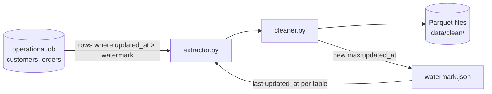

# Incremental Data Cleaning Pipeline (Watermark-Based)

A small ETL project that builds an operational SQLite database, then **incrementally** cleans its tables and exports them to Parquet files. A `watermark.json` file stores the last processed `updated_at` for each table, so each run only handles **new or modified rows** instead of re-reading the whole database.

## How it works



1. **Create the database** (`scripts.py`): builds `operational.db` with two tables, `customers` and `orders`, and inserts sample data.
2. **Extract** (`extractor.py`): reads `watermark.json` and queries only rows with `updated_at` strictly greater than the stored watermark.
3. **Clean** (`cleaner.py`): applies the cleaning rules to the new rows and writes them to Parquet.
4. **Update the watermark**: the max `updated_at` of the processed rows is saved back to `watermark.json`. The next run starts from there.

If no new rows exist for a table, it is skipped and its watermark stays unchanged.

## Data model

**customers**

| Column | Type | Notes |
|---|---|---|
| customer_id | Integer | Primary key |
| name | String | Required |
| email | String | Required, unique |
| country | String | |
| created_at | DateTime | |
| updated_at | DateTime | Used for the watermark |

**orders**

| Column | Type | Notes |
|---|---|---|
| order_id | Integer | Primary key |
| customer_id | Integer | Foreign key → `customers.customer_id` |
| order_date | DateTime | Required |
| total_amount | Float | |
| status | String | |
| updated_at | DateTime | Used for the watermark |

## Cleaning rules

| Table | Rules |
|---|---|
| customers | Strip whitespace and lowercase `name`, `email`, `country` |
| orders | Drop rows where `total_amount <= 0`; strip whitespace and lowercase `status` |

## Watermark

`watermark.json` keeps one timestamp per table:

```json
{
    "customers": { "updated_at": "2025-06-30 10:40:00" },
    "orders":    { "updated_at": "2025-09-20 11:45:00" }
}
```

- Rows are selected with `updated_at > watermark` (a row equal to the watermark is **not** reprocessed).
- To reprocess everything, reset both values to `1970-01-01 00:00:00`.

## Project structure

```
.
├── data/
│   ├── database/
│   │   ├── operational.db
│   │   └── watermark.json
│   └── clean/
│       ├── customers.parquet
│       └── orders.parquet
├── src/
│   ├── __init__.py
│   ├── extractor.py      # load/get/update/save watermark
│   └── cleaner.py        # cleaning functions + pipeline entry point
├── tests/
│   ├── test_extractor.py
│   └── test_cleaner.py
├── scripts.py            # creates and seeds the database
├── requirements.txt
└── README.md
```

## Getting started

### 1. Install

```bash
git clone <your-repo-url>
cd <your-repo-name>
python -m venv .venv
source .venv/bin/activate        # Windows: .venv\Scripts\activate
pip install -r requirements.txt
```

### 2. Create the database

```bash
mkdir -p data/database data/clean
python scripts.py
```

### 3. Initialize the watermark (first run)

Create `data/database/watermark.json` so that the first run processes everything:

```json
{
    "customers": { "updated_at": "1970-01-01 00:00:00" },
    "orders":    { "updated_at": "1970-01-01 00:00:00" }
}
```

### 4. Run the pipeline

From the project root:

```bash
python -m src.cleaner
```

Cleaned files are written to `data/clean/`, and `watermark.json` is updated.

Run it again right away and you should see:

```
no new rows for customers table
no new rows for orders table
```

To simulate new data, insert or update a row in `operational.db` with a newer `updated_at`, then run the pipeline again. Only that row will be processed.

## Tests

```bash
pytest
```

The tests cover:

- **Extractor:** which rows are returned for a given watermark (including the strict `>` boundary), watermark updates, empty DataFrames, a second extraction returning nothing, and saving/loading the JSON file.
- **Cleaner:** whitespace stripping, lowercasing, null handling, removal of non-positive amounts, column order, and empty input.

## Tech stack

- Python 3
- [Polars](https://pola.rs/): data cleaning and Parquet export
- [SQLAlchemy](https://www.sqlalchemy.org/): database access (SQLite)
- [pytest](https://pytest.org/): testing

## Known limitations / ideas for improvement

- Each run **overwrites** the Parquet files with only the new rows. To keep a full history, append to the existing file or write one file per run (e.g. partitioned by date).
- Rows with `total_amount <= 0` are dropped silently; logging or quarantining them could help auditing.
- The watermark is advanced after cleaning but is saved once at the end of the run; a crash midway could leave it out of sync with the output files.
